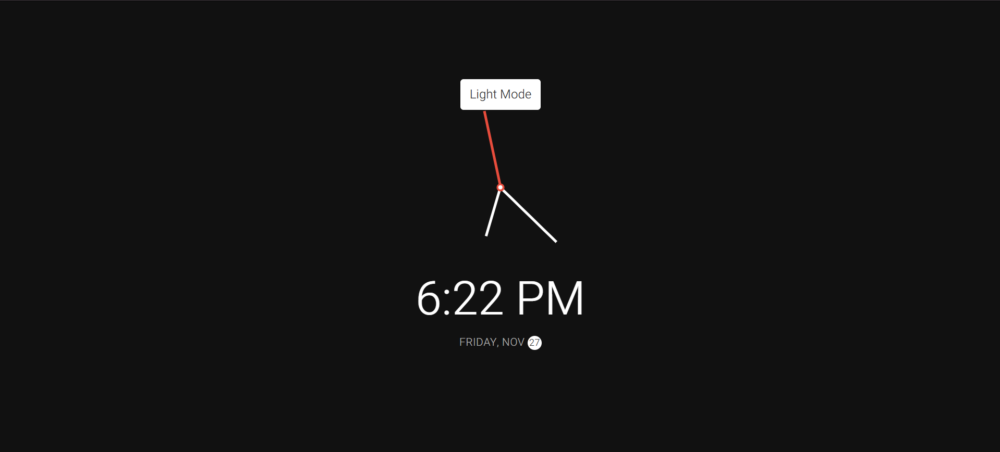

# Theme Clock ⏰

An elegant, real-time analog and digital clock that features a smooth Dark/Light mode toggle.

## 🚀 Features
- **Real-Time Updates:** The analog needles and digital text update every second using JavaScript.
- **Dark/Light Mode:** Click the toggle button to switch themes. The colors transition smoothly using CSS variables.
- **Responsive Design:** The clock stays perfectly centered on any screen size.

## 🛠️ Technologies Used
- **HTML5**
- **CSS3** (Variables & Transitions)
- **JavaScript (ES6)**

## 🚀 How to Run
1. Open the `Project_53_Theme_Clock` folder.
2. Double-click `index.html` to open it in your browser.
3. Click the **"Dark Mode"** button to see the theme transition!